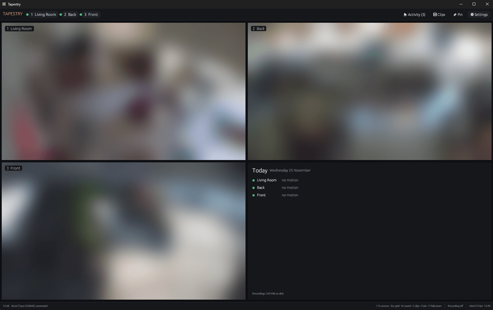
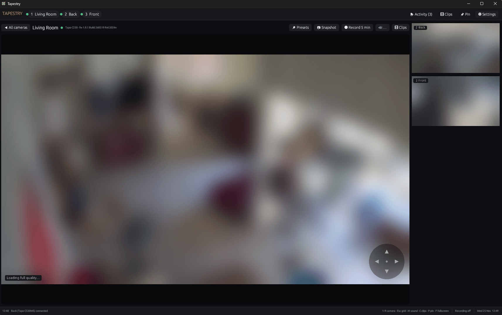
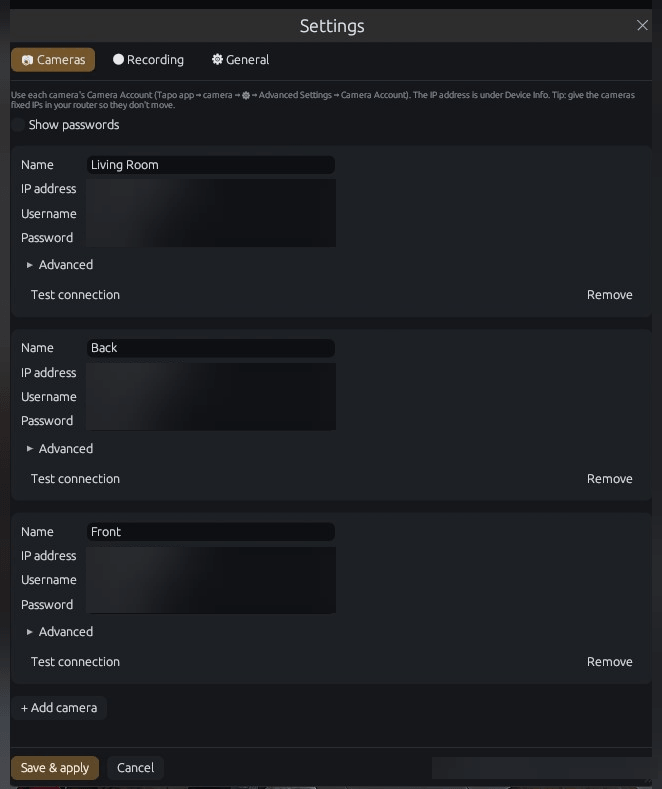
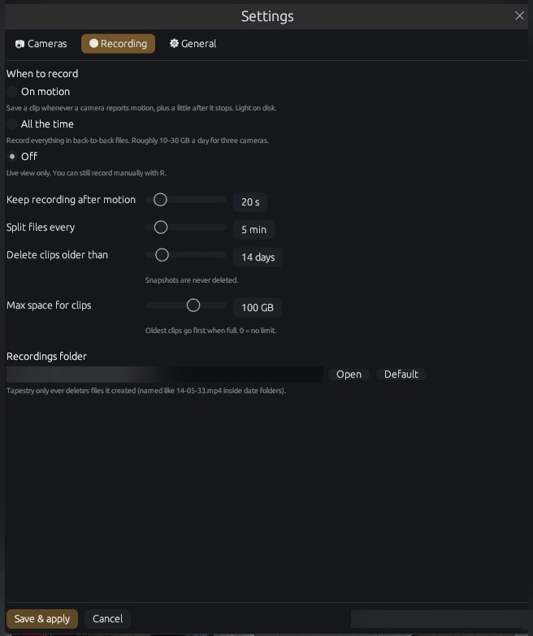

# Tapestry

A desktop wall for your Tapo cameras. All of them live in one window you can alt-tab to,
with pan/tilt, motion alerts, and clips saved to your PC.

TP-Link has never made a Tapo app for Windows or Mac, and people have been
[asking for one since 2020](https://community.tp-link.com/en/home/forum/topic/205220).
Tapestry is a free, open-source answer for wired Tapo cameras on your home network.

> Unofficial. Not affiliated with or endorsed by TP-Link. Tapo is a trademark of TP-Link.


<sub>Camera feeds blurred for privacy.</sub>

- **Live grid** of every camera (low-res streams, light on CPU), plus a "Today" card in the spare slot
- **Open a camera** (click it, or press `1`–`9`) for the full-quality stream with:
  - **Pan/tilt**: hold the on-screen arrows, arrow keys or `WASD` (`Shift` = slow)
  - **Click-to-aim**: click anywhere on the video and the camera turns toward it
  - **Digital zoom**: scroll to zoom into the 3K picture, drag to look around
  - **Sound** from the camera's microphone (`M` to mute, right-click for volume)
  - **Presets** (if you've saved any in the Tapo app), **Snapshot** (`Ctrl+S`), **Record 5 min** (`R`)
  - The other cameras stay visible in a strip down the side
- **Motion alerts**: tiles glow red, the window title says `● Motion: Garden`, and the taskbar
  button flashes if Tapestry isn't in front
- **Recording** on motion (default), all the time, or off. Clips go to `Videos\Tapestry`,
  old ones are cleaned up automatically
- **Clips panel** (`C`): a 24-hour timeline per camera showing recordings (teal) and motion (red).
  Click any moment to play it. Playback has seek, 1–8× speed, next/previous clip.
- **Pin on top** (`P`) and **fullscreen** (`F`)

Everything uses the cameras' official local protocols (RTSP for video, ONVIF for pan/tilt and
motion). Nothing goes through the cloud, and firmware updates shouldn't break it.



<details>
<summary>Settings screenshots</summary>




</details>

---

## One-time setup

### 1. Give each camera a Camera Account (in the Tapo phone app)

For each camera: **Camera → ⚙ Settings → Advanced Settings → Camera Account**. Choose a
username and password. This login is separate from your TP-Link account. Using the same
login on every camera is fine.

While you're there, note each camera's **IP address** (**Settings → Device Info**). It's worth
reserving those IPs in your router (look for "DHCP reservation" or "address reservation"),
so the cameras keep the same address.

> Works with: C230 ✓, C530WS ✓. (Battery cameras like the C410/C420/C425 don't offer local
> video.)

### 2. Get Tapestry

Download `tapestry-<version>-windows-x64.zip` from the
[latest release](https://github.com/sinnu-guild/tapestry/releases/latest) and extract it anywhere
(e.g. `C:\Tools`). Run `tapestry.exe` from the extracted `Tapestry` folder, and right-click it to pin
it to the taskbar or Start. Windows SmartScreen may warn about an unsigned app the first time:
**More info → Run anyway**.

FFmpeg, which Tapestry uses for all video, is included in the zip (`ffmpeg.exe`), so there's
nothing else to install. To update Tapestry later, replace just `tapestry.exe` with the one from
the newest release.

<details>
<summary>Or build it yourself</summary>

You also need FFmpeg. In PowerShell: `winget install Gyan.FFmpeg` (Tapestry finds it there
automatically), or put `ffmpeg.exe` next to `tapestry.exe`.

You need Rust ([rustup.rs](https://rustup.rs)). If you already have it, run `rustup update`
first. In this folder:

```
cargo run --release
```

The first build downloads its dependencies and takes a few minutes. After that, the app is at
`target\release\tapestry.exe`.

</details>

On first launch the Settings window opens. Add your cameras (name, IP, Camera Account
login) and press **Test connection** on each one. When they all show green ticks, press
**Save & apply**.

---

## Keyboard

| Key | Does |
|---|---|
| `1`–`9` | Open that camera |
| `Esc` / `0` | Back to the grid (or leave fullscreen) |
| Arrows / `WASD` | Pan/tilt the open camera (hold `Shift` for slow) |
| `Ctrl+S` | Snapshot (full resolution JPEG) |
| `R` | Record now for 5 minutes / stop |
| `M` | Sound on/off for the open camera (right-click the sound button for volume) |
| `C` | Clips panel |
| `P` | Pin on top of other windows |
| `F` / `F11` | Fullscreen |
| `Space`, `←` `→` | Play/pause and skip 10 s (during playback) |

Right-click any tile for more options.

## Where things live

| What | Where |
|---|---|
| Settings | `%APPDATA%\Tapestry\tapestry.ini` (plain text, safe to edit while Tapestry is closed) |
| Clips | `Videos\Tapestry\<camera>\<date>\<time>.mp4` |
| Snapshots | `Videos\Tapestry\<camera>\snapshots\` (never auto-deleted) |
| Motion history | `Videos\Tapestry\<camera>\motion.csv` |

Clips are fragmented MP4 files. If the PC loses power mid-recording, the part already
recorded still plays. Cleanup only deletes files Tapestry created (named like
`14-05-33.mp4` inside date folders), so other videos in that folder are never touched.

**Heads-up:** your camera passwords are stored as plain text in `tapestry.ini`. They are
camera-only logins, not your TP-Link account, so the risk is small. Still, don't share that file.

## How it fits with the Tapo app

- Your phone app keeps working as before.
- The cameras allow only two of these three at once: Tapo Care cloud recording, SD-card
  recording, and recording by a PC app like Tapestry. Without Tapo Care, SD card + Tapestry is
  fine.
- Motion alerts here come from the camera's basic motion detector. Person and vehicle detection
  isn't exposed to PC apps, so expect the occasional tree or cat.
- Tapestry only works on your home network. That's what it's for: watching from your desk.

## Troubleshooting

**Check a camera from the command line.** This prints the model, streams, pan/tilt support
and presets, and listens for motion for 20 seconds:

```
cargo run --release -p tapestry-core --bin tapestry-probe -- 192.168.1.50 myuser mypass --wiggle
```

`--wiggle` turns the camera briefly right then left to prove pan/tilt works.

| Symptom | Likely cause |
|---|---|
| "Wrong camera username/password" | Use the Camera Account, not your TP-Link login |
| "Camera not reachable" | Wrong IP, the camera changed IP, or the PC is on a guest/isolated Wi-Fi |
| "Camera is busy" | Too many viewers at once. Close the camera in the phone app and try again |
| Video works but no motion alerts | Check that motion detection is on in the Tapo app for that camera |
| Click-to-aim overshoots | Settings → General → lower "Aim strength" |
| Pan/tilt goes the wrong way | Settings → camera → Advanced → "mounted upside down" |

## Project layout

```
crates/core   tapestry-core: ONVIF client, FFmpeg streams, recorder, clips, engine.
              No dependencies beyond Rust's standard library.
              `cargo test -p tapestry-core` runs 44 tests, including a fake Tapo camera.
crates/app    tapestry: the window (egui/eframe).
docs/         design notes and screenshots.
packaging/    extra files for the release zip (FFmpeg notice).
```

## License

Dual-licensed under [MIT](LICENSE-MIT) or [Apache-2.0](LICENSE-APACHE), at your option.
